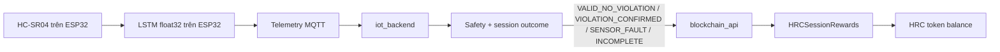

# HRC session rewards và edge LSTM

Tài liệu này ghi lại lần triển khai local ngày **10/10/2026**. Blockchain dùng
Hardhat chain `31337` trên `127.0.0.1`; đây chưa phải deployment lên Sepolia hay
mạng thật.

## Luồng chạy



LSTM trên firmware chỉ dự báo khoảng cách trong 5 horizon `[100, 200, 300,
400, 500] ms`. Lớp safety hiện tại quyết định trạng thái từ số đo hợp lệ và
`Sp`; LSTM tạo cảnh báo sớm, không tự quyết định phạt. Khi session đóng,
`iot_backend` cung cấp kết quả qua:

```text
GET /sessions/{session_id}/outcome
```

Client/collector lấy `result.outcome`, rồi gửi kết quả cùng `beneficiary` và
`evidenceHash` đến:

```text
POST /api/session-outcome
```

`blockchain_api` chỉ cho phép settle bằng outcome cố định; số lượng token do
contract quyết định, nên HTTP client không thể tự chọn tiền thưởng hay tiền
phạt. Trước khi settle, beneficiary phải bắt đầu session on-chain và approve
contract nhận stake.

Trong demo, `iot_backend` gọi bridge tự động khi các biến `HRC_REWARD_AUTO_START`
và `HRC_REWARD_AUTO_SETTLE` được bật. Nếu blockchain API tạm thời không sẵn sàng,
session IoT vẫn được lưu; endpoint `POST /sessions/{session_id}/settle` cho phép
retry thủ công sau khi dịch vụ trở lại.

Bridge lưu bảng `reward_settlements` trong SQLite với các trạng thái:

| Trạng thái | Ý nghĩa |
|---|---|
| `PENDING` | Đã khóa outcome/evidence trước khi gọi API ghi chain |
| `ERROR` | Lần gọi thất bại; được retry với cùng evidence hash |
| `SETTLED` | Đã có response cuối; retry chỉ đọc lại response đã lưu |

Private key chỉ nằm trong `blockchain_api/.env`. `iot_backend` chỉ giữ URL, bearer
token và beneficiary; dashboard chỉ đọc API, không nhận key hoặc token.

## Policy contract

| Kết quả session | Stake | Reward | Penalty | Settlement |
|---|---:|---:|---:|---|
| `VALID_NO_VIOLATION` lần đầu trong UTC day | trả 2 HRC | +3 HRC | 0 | `REWARDED` |
| `VALID_NO_VIOLATION` lần tiếp theo trong ngày | trả 2 HRC | 0 | 0 | `REWARD_DAILY_LIMIT` |
| `VIOLATION_CONFIRMED` | 0 | 0 | −2 HRC | `PENALTY` |
| `SENSOR_FAULT` hoặc `INCOMPLETE` | trả 2 HRC | 0 | 0 | `NO_REWARD` |

Quỹ khởi tạo là 1.000 HRC và không mint thêm token theo session. Một session
chỉ được settle một lần; retry cùng `sessionId` và cùng evidence là idempotent.
Nếu đã xác nhận vi phạm thì lỗi cảm biến xuất hiện sau đó không xóa được vi
phạm.

## Địa chỉ local

Hardhat local là chain tạm thời nên không có địa chỉ contract cố định trong Git.
`./scripts/run_local_demo.sh` deploy lại và ghi hai manifest của đúng lần chạy vào
`.runtime/local-demo/latest/deployments/`. RPC dùng `http://127.0.0.1:8545` và
API dùng `http://127.0.0.1:3000`.

## Kết quả triển khai

Contract và blockchain API regression đều đang pass; số lượng hiện tại được ghi
trong README cùng lệnh kiểm tra. Smoke settlement đã kiểm tra:

- session hợp lệ: `REWARDED`, user nhận 3 HRC;
- session hợp lệ thứ hai trong cùng ngày: `REWARD_DAILY_LIMIT`;
- vi phạm: `PENALTY`, user mất 2 HRC;
- lỗi cảm biến: `NO_REWARD`, stake được trả lại;
- retry session đã settle: `duplicate=true`, không tạo transaction mới.

Smoke bridge MQTT đã chạy một session telemetry live trong 30 giây với 313 mẫu,
outcome `VALID_NO_VIOLATION`; lần settle đó trả stake 2 HRC và nhận
`REWARD_DAILY_LIMIT` vì beneficiary đã nhận reward trước đó trong cùng UTC day.
Đây là kết quả đúng policy, không phải lỗi transaction. Session ngắn không đủ
coverage cho kết quả `INCOMPLETE` và được trả stake, không bị phạt.

Smoke chạy với số dư beneficiary ban đầu 20 HRC và kết thúc ở 21 HRC sau chuỗi
`+3`, `0`, `−2`, `0`; quỹ giảm từ 1.000 xuống 997 HRC. Kết quả đầy đủ nằm ở
[data/results/edge-blockchain-20261010/reward-smoke.json](../../data/results/edge-blockchain-20261010/reward-smoke.json),
còn báo cáo máy đọc ở
[data/results/edge-blockchain-20261010/deployment-report.json](../../data/results/edge-blockchain-20261010/deployment-report.json).

Hình minh họa policy:

- [reward-policy.png](../../data/results/edge-blockchain-20261010/reward-policy.png)
- [reward-policy.svg](../../data/results/edge-blockchain-20261010/reward-policy.svg)

## Edge LSTM

Firmware dùng đúng model canonical `ai_model/artifacts/lstm-v1`. Artifact này
được train synthetic-only cho demo và không phải chứng nhận an toàn phần cứng.
Contract artifact của firmware là:

- input `(10, 2)`: `[distance_m, delta_distance_m]`;
- output `(5,)` theo 5 horizon;
- threshold `0.040 m = 40 mm`;
- SHA-256 model/scaler: xem `ai_model/artifacts/lstm-v1/manifest.json`.

Native parity có **7 passing, 1 skipped**; bài skipped chỉ yêu cầu `h5py` trên
máy tạo lại weights. ESP-IDF **6.0.1** build target **ESP32-S3** đã pass, binary
nằm ở `firmware/esp32/build/hrc_esp32.bin`.

Trong lần triển khai này không có `/dev/ttyACM*` hoặc `/dev/ttyUSB*`, vì vậy
firmware chưa được flash và chưa có log LSTM từ phần cứng. Khi cắm đúng board,
kiểm tra chip trước rồi chạy:

```bash
source /home/lucas/.espressif/v6.0.1/esp-idf/export.sh
cd firmware/esp32
idf.py -p /dev/ttyACM0 flash monitor
```

Chỉ dùng `/dev/ttyACM0` nếu `esptool chip-id` xác nhận đó là ESP32-S3; với ESP32
classic phải build target `esp32` riêng.

Các ảnh đánh giá canonical đang ở
[data/results/lstm-v1/figures](../../data/results/lstm-v1/figures).
Mọi metric trong bundle này phải được hiển thị là synthetic-only; không dùng
MAE/RMSE để suy diễn an toàn phần cứng.
