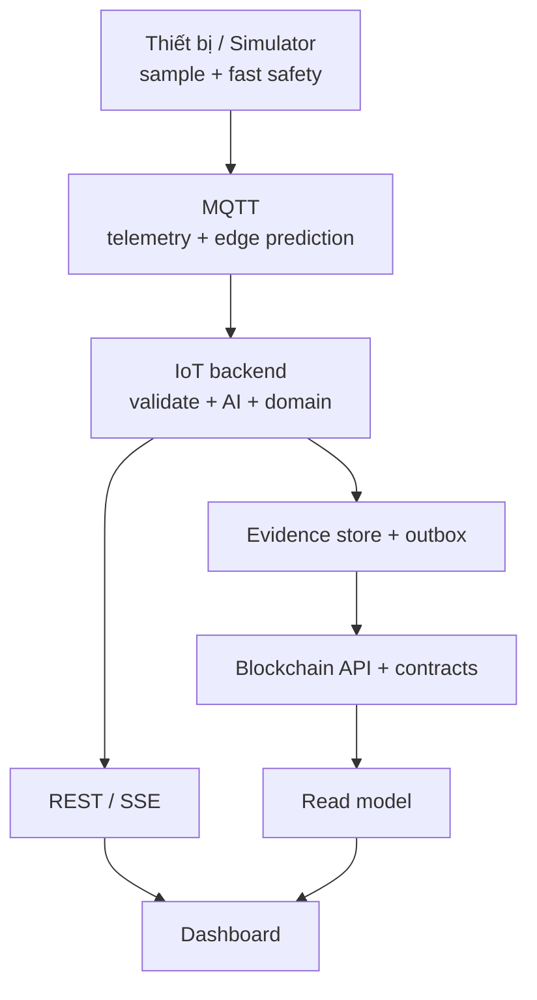
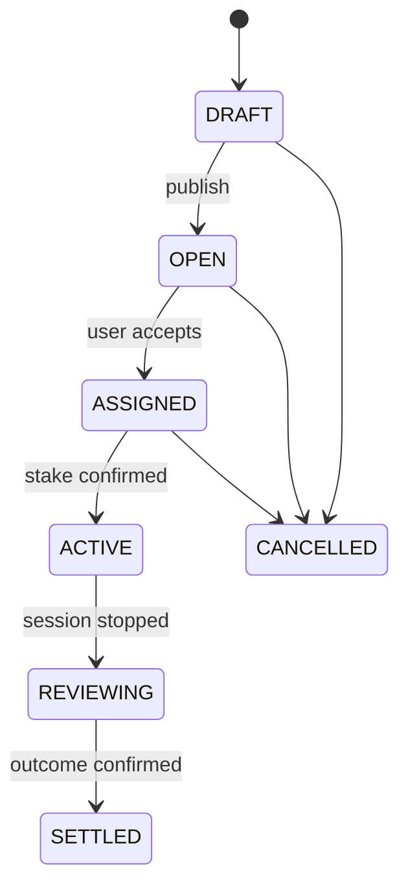
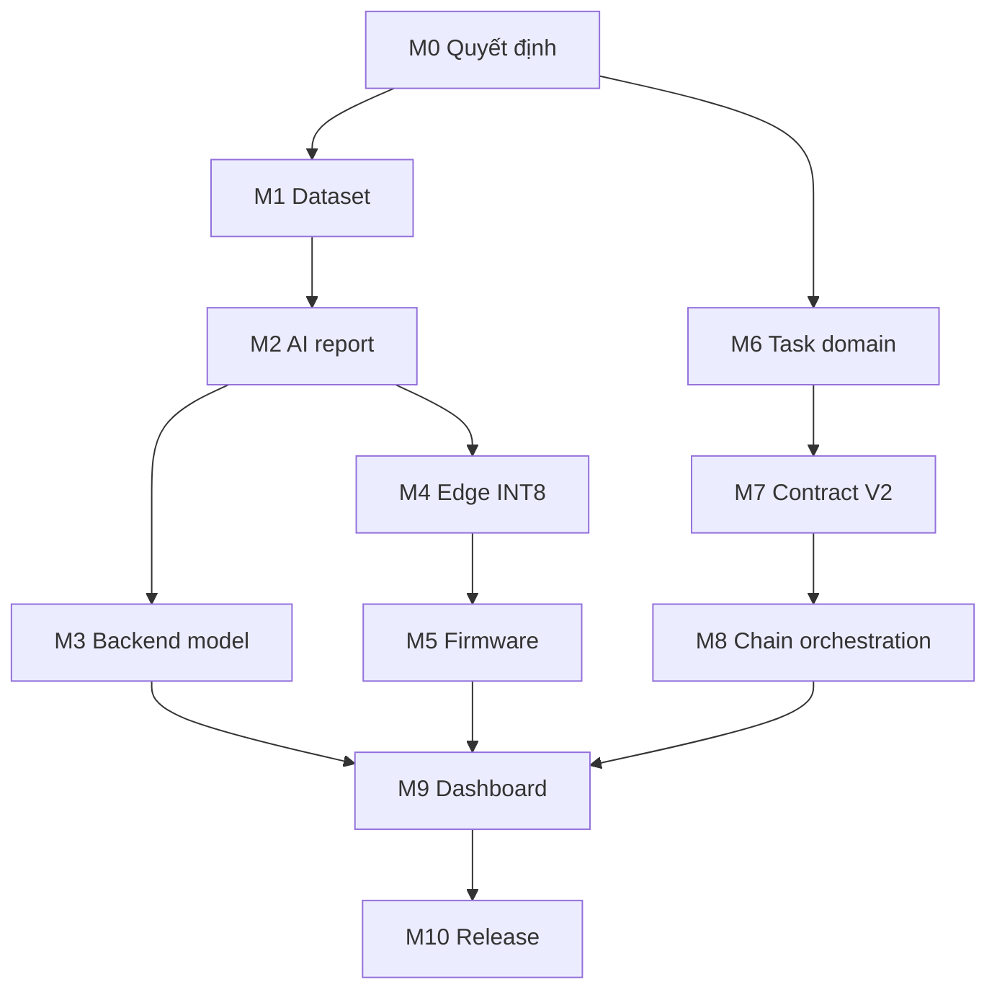

# Kế hoạch triển khai hoàn chỉnh — AI, Edge AI, Blockchain và Dashboard

> Trạng thái: **PROPOSED — tài liệu thiết kế, chưa cho phép tự động triển khai source**
>
> Ngày chốt baseline: **2026-10-10**
>
> Baseline repository: `lucas-traumen/Blockchain-IoT`
>
> Baseline commit: `42f1776687d5b44006250d9fb025c80ebb2df0d4`
>
> Phạm vi AI: **synthetic-only**; không bắt buộc thu dữ liệu cảm biến thật trong phiên bản này.
>
> Tên sản phẩm làm việc: **HRC Safe-to-Earn** — hoàn thành nhiệm vụ robot an toàn để nhận phần thưởng HRC.

Tài liệu này là kế hoạch hợp nhất để đưa repository hiện tại từ một bản demo kỹ
thuật thành một demo sản phẩm có thể giải thích, vận hành, kiểm thử và đánh giá
được từ đầu đến cuối. Tài liệu bao phủ năm phần liên kết chặt với nhau:

1. sinh dữ liệu mô phỏng, huấn luyện và báo cáo đánh giá AI;
2. triển khai inference tại backend và Edge AI trên ESP32;
3. chuẩn hóa luồng task/session/safety/reward;
4. ghi bằng chứng và settlement lên blockchain;
5. hoàn thiện dashboard theo vai trò người dùng, chủ hệ thống và kiểm toán viên.

Tài liệu không tuyên bố hệ thống đạt chứng nhận an toàn công nghiệp. Model được
đánh giá trên dữ liệu mô phỏng chỉ được ghi là **synthetic-validated**. Blockchain
là lớp bằng chứng và thanh toán bất đồng bộ; blockchain không được dùng làm vòng
điều khiển dừng robot thời gian thực.

---

## 1. Cách sử dụng kế hoạch

- Đây là tài liệu kiến trúc và execution plan. Sau khi được duyệt, từng milestone
  phải được đưa vào `PLAN.md` với task key, người phụ trách, file được phép sửa,
  lệnh kiểm tra và evidence.
- Không đánh dấu một milestone là hoàn thành chỉ vì code đã tồn tại. Phải có
  artifact, test, metric và bằng chứng tái lập tương ứng.
- Mọi thay đổi schema, contract hoặc chính sách token phải có migration/version;
  không sửa ngầm dữ liệu hoặc session đang chạy.
- Nếu code hiện tại khác tài liệu, code không tự động trở thành đúng. Phải ghi
  decision record rồi cập nhật một trong hai.
- Các ngưỡng số trong phần release gate là ngưỡng đề xuất ban đầu. Nếu nhóm đổi
  ngưỡng, phải đổi trước khi mở test set và ghi lý do trong decision log.

---

## 2. Kết luận kiến trúc

### 2.1 Mục tiêu sản phẩm

Người dùng không nhận coin chỉ vì “đứng yên không vi phạm”. Người dùng nhận
thưởng khi hoàn thành một **nhiệm vụ đã đăng ký** và toàn bộ phiên làm việc đủ
dữ liệu, không có vi phạm được xác nhận.

Ví dụ trải nghiệm:

1. Chủ hệ thống tạo nhiệm vụ “chạy robot 20 chu kỳ trong vùng làm việc A”.
2. Người dùng kết nối ví, đọc quy tắc và khóa `0.200 HRC` làm stake.
3. Người dùng bắt đầu session; ESP32 đo khoảng cách, safety fast lane giám sát
   ngưỡng và Edge AI dự báo 100–500 ms.
4. Backend xác nhận task completion và kết quả an toàn từ bằng chứng đã lưu.
5. Session an toàn, hợp lệ và hoàn thành nhiệm vụ: trả lại stake và cộng
   `0.002 HRC`.
6. Có vi phạm được xác nhận: thu `0.010 HRC`, hoàn lại `0.190 HRC`.
7. Lỗi cảm biến/hạ tầng không do người dùng: hoàn lại toàn bộ stake, không thưởng.
8. Dashboard hiển thị kết quả, lý do, evidence hash và transaction receipt.

### 2.2 Quy tắc an toàn cốt lõi

- Đo thực tế vượt ngưỡng phải kích hoạt fast lane ngay tại thiết bị; không chờ AI,
  MQTT, backend hoặc blockchain.
- AI chỉ dự báo tương lai để cảnh báo sớm. AI không được làm một mẫu đo vi phạm
  trở thành an toàn.
- `PREDICTED_WARNING` không phạt token.
- Một mẫu nhiễu tạo `VIOLATION_OBSERVED`, nhưng chỉ
  `VIOLATION_CONFIRMED` theo quy tắc 2 trong 3 mẫu valid liên tiếp mới đủ điều
  kiện ghi DANGER lên chain và áp dụng penalty.
- `UNKNOWN`, dropout, reset thiết bị hoặc mất mạng phải chuyển hệ thống sang
  trạng thái fail-safe, nhưng không tự động phạt người dùng.
- “Robot locked” trên smart contract là khóa logic/audit. Nó không thay thế relay,
  contactor hoặc chân stop vật lý trên ESP32.

### 2.3 Quy tắc sản phẩm cốt lõi

- Reward gắn với `task_id` và bằng chứng hoàn thành, không chỉ gắn với thời gian.
- Policy của một session được chụp bất biến khi session bắt đầu; chủ hệ thống
  không được đổi stake/reward/penalty giữa phiên.
- Backend/operator chỉ gửi outcome và evidence hash. Contract tự ánh xạ outcome
  sang số tiền đã khóa; client không được tự chọn số thưởng/phạt.
- Không dùng từ “giá thị trường” cho HRC demo. Dashboard hiển thị
  `reference_value`, ví dụ `1 HRC = 10.000 VND`, kèm nhãn “giá trị quy đổi
  tham chiếu trong demo, không cam kết mua lại”.
- Bản local/testnet không xử lý tiền pháp định thật. Mua coin bằng VND thật là
  module tương lai cần cổng thanh toán, KYC/AML, pháp lý và đối soát riêng.

---

## 3. Đánh giá baseline tại commit 42f1776

| Khối | Đã có trong repository | Chưa đủ để gọi là hoàn chỉnh |
|---|---|---|
| Synthetic data | `scripts/synthetic_v2.py`, cấu hình `square-bench-v2`, 1.200 forecast session + 150 fault session, seed/split/hash | Chưa có release dataset V2 và report cuối được khóa, ký hash và công bố |
| AI backend | Keras/TensorFlow LSTM, input `10×2`, output 5 horizon; persistence và constant-velocity baseline; event metrics | Chưa có candidate V2 được train/evaluate/promote theo gate thống nhất |
| Safety | CLEAR/VIOLATION/UNKNOWN; cảnh báo dự báo; xác nhận vi phạm 2/3 valid sample | Cần chuẩn hóa sản phẩm thành CLEAR/WARNING/VIOLATION/UNKNOWN và log transition rõ |
| Edge AI | Có LSTM float32 viết tay bằng C và weight nhúng trong firmware | Artifact nhúng đang mang identity cũ; chưa INT8/TFLite Micro, chưa benchmark thiết bị, chưa publish edge prediction |
| Edge contract | Có `edge_prediction_v1.schema.json` và bảng `edge_predictions` | Firmware hiện chủ yếu log forecast; chưa có đường MQTT → ingest → parity report hoàn chỉnh |
| Event/chain bridge | Có event package, durable `chain_event_outbox`, retry/dead-letter, endpoint trạng thái | Cần E2E outage recovery và đối soát hash/receipt ở release bundle |
| Blockchain safety | `HRCSafetyLog`, EIP-712 cho thiết bị đăng ký, DANGER tạo logical lock | Logical lock chưa gắn với interlock vật lý; cần nêu rõ hai cơ chế |
| Token/reward | ERC-20 fixed supply và `HRCSessionRewards`; stake 2, reward 3, penalty 2 HRC | Chính sách hiện tại không phù hợp mức cộng/trừ nhỏ; chưa có task completion và policy snapshot mỗi session |
| Backend reward | Kết quả deterministic, confirmed violation ưu tiên, fault/incomplete không bị phạt | Minimum 30 s/20 mẫu quá yếu ở 10 Hz; chưa kiểm tra task/cycle/evidence |
| Dashboard live | REST/SSE, biểu đồ actual/Sp/5 forecast, source labels, chain status, responsive smoke | Vẫn là dashboard demo kỹ thuật; chưa có onboarding, task marketplace, role/permission và AI report đầy đủ |
| Vận hành | Docker cho MQTT/backend, local Hardhat/API, test suites | Chưa có một release manifest và một kịch bản dựng toàn stack có health tổng hợp |

### 3.1 Mâu thuẫn baseline phải xử lý đầu tiên

Firmware hiện chứa weight float32 có header trỏ tới artifact
`lstm-real-20261010`, trong khi cấu hình model hiện ghi
`training_data: synthetic-only`. Không được phát hành firmware khi identity
model trong:

- `model.keras`;
- `manifest.json`;
- `scaler.json`;
- source/header firmware;
- MQTT edge prediction;
- backend active model;
- dashboard;

không khớp cùng một `model_sha256`, `scaler_sha256`,
`preprocessing_version` và `dataset_release_id`.

---

## 4. Kiến trúc đích

### 4.1 Năm lớp độc lập



| Lớp | Trách nhiệm | Không được làm |
|---|---|---|
| Thiết bị | đo, kiểm tra valid, fast stop, Edge AI advisory | chờ blockchain để dừng |
| Ingestion/AI | raw-first commit, validate, backend prediction, state/event | nhận ground truth synthetic ở runtime |
| Domain | task, session, completion, policy, outcome, evidence | để UI tự tính thưởng/phạt |
| Blockchain | bất biến event hash, escrow, settlement, receipt | lưu raw telemetry 10 Hz |
| Dashboard | trình bày, thao tác theo role, giải thích bằng chứng | giữ private key operator hoặc hard-code số liệu |

### 4.2 Hai đường xử lý

**Fast lane, mục tiêu dưới một chu kỳ 100 ms**

```text
HC-SR04 → validate → distance <= Sp hoặc sensor fault
         → GPIO interlock/cảnh báo cục bộ → structured device log
```

**Audit/reward lane, bất đồng bộ**

```text
telemetry → MQTT → raw DB → backend AI → confirmed event
          → evidence package → outbox → blockchain → dashboard
```

Chain outage chỉ làm giao dịch ở `PENDING/RETRYABLE_ERROR`. Nó không được làm
dừng lấy mẫu, safety, AI, lưu local hoặc dashboard live.

### 4.3 Nguồn sự thật

| Dữ liệu | Nguồn có thẩm quyền |
|---|---|
| Phép đo | raw `telemetry_v1` đã commit |
| Ground truth benchmark | dataset release synthetic bất biến |
| Safety hiện tại | direct rule từ raw sample và safety config |
| Dự báo | backend model active; edge model dùng parity/advisory |
| Event | event package được tạo atomic cùng detector state |
| Task completion | completion evidence từ robot/controller hoặc owner-approved evidence |
| Outcome | policy engine versioned trên backend |
| Tiền | state/event của reward contract |
| UI | chỉ đọc API/read model, không tự suy diễn |

---

## 5. Mô hình miền và state machine

### 5.1 Thực thể bắt buộc

| Thực thể | Khóa | Nội dung chính |
|---|---|---|
| User | `user_id` | profile tối thiểu, wallet, trạng thái |
| Device | `device_id` | signer, firmware, model, safety config, trạng thái |
| Task | `task_id` | mô tả công việc, device/zone, điều kiện hoàn thành, policy |
| Assignment | `assignment_id` | task–user, thời hạn, trạng thái |
| Session | `session_id` | task/user/device, thời gian, policy snapshot, model/config hash |
| Sample | device/boot/sequence | raw telemetry bất biến |
| Assessment | sample ref + processor version | safety + backend prediction |
| EdgePrediction | sample ref + model hash | dự báo và latency trên thiết bị |
| SafetyEvent | `event_id` | observed/confirmed, pre/post evidence |
| CompletionEvidence | `evidence_id` | cycle count, controller ack hoặc owner approval |
| Settlement | `session_id` | outcome, amounts, evidence hash, tx state |
| ModelRelease | `model_sha256` | dataset/split/scaler/report/toolchain hashes |

### 5.2 Task state



Không cho chuyển thẳng `ACTIVE → SETTLED`; luôn phải qua đánh giá evidence.

### 5.3 Session state

| State | Điều kiện vào | Hành động |
|---|---|---|
| CREATED | assignment hợp lệ | chụp policy/model/config versions |
| STAKE_PENDING | cần approve/lock token | chờ receipt, có timeout |
| READY | stake đã khóa hoặc demo mode đã cấp quyền | cho phép start |
| RUNNING | device ack start | nhận sample/completion evidence |
| STOPPING | user/owner/violation yêu cầu dừng | đóng cửa sổ hậu sự kiện |
| EVALUATING | raw đã ổn định | chạy policy deterministic |
| CHAIN_PENDING | evidence frozen | enqueue settlement |
| SETTLED | receipt confirmed | khóa outcome |
| REFUND_PENDING | lỗi kỹ thuật/cancel | enqueue refund |
| DISPUTED | chỉ dùng nếu sản phẩm bật quy trình khiếu nại | chặn payout cuối nếu thiết kế escrow hỗ trợ |

### 5.4 Safety/event state

- `CLEAR`: mẫu valid và khoảng cách lớn hơn Sp; không có cảnh báo đã debounce.
- `WARNING`: hiện tại vẫn CLEAR nhưng ít nhất 2 trong 3 backend/edge prediction
  hợp lệ dự báo một horizon sẽ chạm Sp.
- `VIOLATION_OBSERVED`: mẫu valid hiện tại `distance <= Sp`; fast stop ngay.
- `VIOLATION_CONFIRMED`: tối thiểu 2 trong 3 mẫu valid liên tiếp vi phạm.
- `UNKNOWN`: cảm biến invalid, mất nhịp, reset boot hoặc cửa sổ không đủ tin cậy.

Event lifecycle:

```text
OBSERVED → CONFIRMED → PACKAGED → OUTBOX_PENDING
         → SUBMITTED → CONFIRMED_ON_CHAIN
                   ↘ RETRYABLE_ERROR → SUBMITTED
                   ↘ DEAD_LETTER → MANUAL_REVIEW
```

Một observed event hết cửa sổ mà không đủ 2/3 trở thành `DISMISSED_NO_PENALTY`;
không xóa event, vì nó vẫn là evidence của nhiễu hoặc near miss.

### 5.5 Model release state

```text
EXPERIMENT → CANDIDATE → OFFLINE_PASS → EDGE_PARITY_PASS
           → DEVICE_BENCH_PASS → ACTIVE → RETIRED
                                  ↘ ROLLED_BACK
```

Chỉ `ACTIVE` được backend và firmware dùng trong demo chính thức.

---

## 6. Vai trò và quyền

| Chức năng | Worker/User | Operator | Owner/Admin | Auditor |
|---|---:|---:|---:|---:|
| Xem task mở | ✓ | ✓ | ✓ | đọc |
| Nhận task/start session | ✓ của mình | hỗ trợ | hỗ trợ | — |
| Xem live session | của mình | tất cả device phụ trách | tất cả | đọc |
| Dừng khẩn cấp | nút yêu cầu | ✓ | ✓ | — |
| Tạo/sửa/publish task | — | theo quyền | ✓ | — |
| Xác nhận completion thủ công | — | ✓ có audit | ✓ | đọc |
| Đổi policy cho task mới | — | — | ✓ | đọc |
| Settle outcome | — | backend operator key | quản lý operator | đọc |
| Retry outbox | — | ✓ | ✓ | đọc |
| Unlock logical robot | — | — | owner contract | đọc |
| Quản lý model active | — | đề xuất | ✓ | đọc |
| Xem/export evidence | của mình | ✓ | ✓ | ✓ |
| Xem private secret | — | — | — | — |

Auth ứng dụng và wallet là hai lớp khác nhau. Wallet chứng minh địa chỉ blockchain;
nó không tự động chứng minh người đó là owner/operator trong ứng dụng.

---

## 7. Hợp đồng dữ liệu

### 7.1 Telemetry

Giữ `telemetry_v1` làm payload nguồn. Không nhét prediction vào payload raw để
tránh đổi nghĩa, phá compatibility và khiến retransmission khó đối soát.

Invariant:

- khóa idempotency là `device_id + boot_id + sequence`;
- `monotonic_us` dùng kiểm tra nhịp;
- `measured_at` chỉ có khi `time_synced=true`;
- invalid sensor dùng `null` theo schema, không giả khoảng cách;
- raw commit trước mọi xử lý AI.

### 7.2 Edge prediction

Publish riêng trên topic gợi ý:

```text
hrc/devices/{device_id}/edge-prediction/v1
```

Payload dùng `edge_prediction_v1.schema.json` và bắt buộc thêm ở phiên bản kế
tiếp nếu schema hiện tại chưa có:

- `firmware_version`;
- `quantization: float32 | int8`;
- `tflite_model_sha256` hoặc `embedded_weights_sha256`;
- `input_scale/input_zero_point`;
- `output_scale/output_zero_point`;
- `arena_bytes`;
- `heap_free_bytes`;
- `clock_mhz`;
- `prediction_status`;
- `fallback_reason`.

Mỗi prediction phải trỏ đúng một `sample_ref`; duplicate cùng sample/model là
idempotent. Prediction đến muộn vẫn được lưu để audit nhưng không rewind live state.

### 7.3 Task definition

Task được lưu off-chain, nhưng hash canonical được chụp vào session:

```json
{
  "schemaVersion": "task-v1",
  "taskId": "task-20261010-001",
  "title": "Hoàn thành 20 chu kỳ robot an toàn",
  "deviceId": "esp32-01",
  "zoneId": "cell-a",
  "completionRule": {
    "type": "robot_cycle_count",
    "requiredCycles": 20,
    "minimumDurationS": 120,
    "maximumDurationS": 900
  },
  "safetyPolicyVersion": "square-bench-v2",
  "rewardPolicyVersion": "task-reward-v1",
  "stakeHrc": "0.200",
  "rewardHrc": "0.002",
  "penaltyHrc": "0.010",
  "dailyRewardCapHrc": "0.010",
  "referenceValueVndPerHrc": "10000",
  "validFrom": "ISO-8601",
  "validUntil": "ISO-8601"
}
```

Số token ở API dùng string decimal; khi gọi contract chuyển sang integer base
unit 18 decimals. Không dùng số float JavaScript để tính token.

### 7.4 Session policy snapshot

Tại `CREATED`, backend canonicalize và băm:

- task definition;
- completion rule;
- reward policy;
- safety config;
- model manifest;
- device/firmware identity;
- user wallet và chain ID.

`session_policy_hash` không đổi đến hết phiên. Nếu owner sửa task sau đó, session
cũ vẫn dùng snapshot cũ.

### 7.5 Completion evidence

Ba nguồn được hỗ trợ theo mức tin cậy:

1. `robot_controller_signed`: controller ký số cycle counter; ưu tiên nhất.
2. `device_reported`: ESP32/gateway gửi cycle count có chữ ký.
3. `owner_approved`: owner xác nhận thủ công; dashboard phải hiển thị rõ manual.

Evidence tối thiểu có `task_id`, `session_id`, counter trước/sau, thời gian,
device/controller identity, source, signature hoặc actor và reason. User không
được tự gửi `completed=true` làm nguồn duy nhất.

### 7.6 Evidence package cuối session

Canonical package phải chứa:

- identity task/session/user/device;
- policy/model/scaler/safety/firmware hashes;
- sample coverage và sequence ranges;
- số CLEAR/WARNING/OBSERVED/CONFIRMED/UNKNOWN;
- danh sách event IDs và hash;
- completion evidence;
- deterministic outcome + reason codes;
- created_at, evaluator version;
- hash raw manifest, không nhúng toàn bộ raw lên chain.

Serialize bằng canonical JSON đã thống nhất rồi SHA-256/Keccak theo đúng interface.
Test golden vector phải chứng minh Python, Node.js và Solidity/client tạo cùng hash.

---

## 8. Kế hoạch dữ liệu mô phỏng

### 8.1 Phạm vi release

Dùng `configs/simulation/square-bench-v2.yaml` làm baseline:

- Sp = 0,04 m;
- chu kỳ = 100 ms;
- window = 10;
- horizon = 100, 200, 300, 400, 500 ms;
- 1.200 forecast session;
- 150 fault session;
- noise, bias, drift, jitter, spike;
- kịch bản stationary, approach, stop-before, recede, oscillation, sudden-step,
  mixed-motion và fault.

Không dùng confusion matrix để sinh dữ liệu. **Scenario matrix sinh dữ liệu**;
confusion matrix chỉ được tính sau khi model dự đoán trên test split đã khóa.

### 8.2 Tách dữ liệu

Quy trình bắt buộc:

1. sinh toàn bộ session với seed rõ;
2. gán `session_id` và `generation_seed`;
3. chia train/validation/test theo session trước khi tạo window;
4. seed của ba split không giao nhau;
5. cùng một trajectory family instance không xuất hiện ở nhiều split;
6. fit scaler trên train-only;
7. tạo window độc lập trong từng split;
8. khóa `split_manifest.json`;
9. chỉ mở test sau khi kiến trúc và threshold đã chốt bằng train/validation.

Tỷ lệ mặc định: 70/15/15 theo session, stratified theo scenario và event support.
Nếu split không có đủ crossing event ở từng scenario quan trọng, generator phải
tạo lại bằng seed mới; không di chuyển từng window thủ công.

### 8.3 Chống leakage

Model feature chỉ được dùng:

- `distance_m`;
- `delta_distance_m`.

Không được đưa vào feature:

- `truth_distance_m`;
- target tương lai;
- scenario name;
- seed;
- split;
- event label;
- threshold crossing time;
- trường được suy ra từ tương lai.

Audit phải kiểm tra trùng `session_id`, seed, exact payload hash và near-duplicate
trajectory fingerprint giữa các split.

### 8.4 Dataset release artifact

```text
data/synthetic/square-bench-v2/
├── dataset.jsonl
├── sessions.jsonl
├── split_manifest.json
├── generator_config.snapshot.yaml
├── generation_manifest.json
├── audit_report.json
├── scenario_support.csv
└── checksums.sha256
```

`generation_manifest.json` phải ghi commit, Python version, dependency lock,
generator version, UTC timestamp, command, seed và hash từng file.

### 8.5 Gate DATA

- Chạy hai lần cùng config/seed cho cùng content hash.
- Không session/seed/hash giao nhau giữa split.
- Mỗi scenario có support đúng theo config.
- Mỗi horizon có target hợp lệ và cùng đơn vị mét.
- Fault session không bị đưa vào forecast training nếu policy không cho phép.
- Không NaN/Infinity.
- Audit leakage = 0.
- Schema validation = 100%.
- Dataset release chỉ đọc sau khi được ký/tag.

---

## 9. Kế hoạch AI backend

### 9.1 Bài toán

LSTM nhận 10 timestep, mỗi timestep gồm:

```text
[distance_m, delta_distance_m]
```

và trả 5 khoảng cách dự báo:

```text
[t+100, t+200, t+300, t+400, t+500 ms]
```

State sản phẩm được suy ra sau regression:

- current valid và `distance <= Sp` → observed violation;
- current CLEAR và forecast bất kỳ horizon `<= Sp` → predicted warning;
- warning chỉ active sau debounce 2/3;
- violation chỉ confirmed sau 2/3 valid samples.

### 9.2 Baseline bắt buộc

Mọi report phải so sánh cùng test windows với:

1. persistence: tương lai bằng khoảng cách hiện tại;
2. constant velocity: ngoại suy từ delta gần nhất;
3. LSTM candidate;
4. Edge INT8 candidate khi có.

Nếu LSTM không hơn baseline đơn giản, không promote chỉ vì “đó là AI”.

### 9.3 Train pipeline

1. Validate dataset release và split manifest.
2. Load config snapshot.
3. Fit scaler train-only.
4. Train với seed cố định; lưu best checkpoint theo `val_loss`.
5. Không dùng test để early stopping hoặc chọn threshold.
6. Xuất `model.keras`, `scaler.json`, `metrics.json`, manifest và history.
7. Chạy evaluator độc lập từ artifact vừa ghi.
8. So hash evaluator input với manifest.
9. Chạy report theo horizon/scenario/noise/event.
10. Promote bằng registry, không đổi thư mục active thủ công.

Kiến trúc baseline hiện tại được giữ làm candidate đầu:

```text
Input(10,2) → LSTM(32) → Dropout(0.2) → Dense(32, ReLU) → Dense(5)
```

Nếu không đạt event gate, thử theo thứ tự:

1. tuning loss/learning rate/window;
2. weighted loss quanh vùng Sp;
3. multi-task head regression + crossing probability;
4. model temporal nhỏ thân thiện INT8 như 1D-CNN/TCN;
5. không tăng model vô hạn nếu Edge không chứa được.

Mỗi thử nghiệm có `experiment_id`; không ghi đè artifact.

---

## 10. Báo cáo đánh giá AI bắt buộc

### 10.1 Regression theo từng horizon

Với mỗi horizon 100–500 ms, báo cáo:

- MAE;
- RMSE;
- median absolute error;
- p90 và p95 absolute error;
- bias trung bình;
- số window;
- metric của ba model/baseline;
- breakdown theo scenario, noise bin và khoảng cách tới Sp.

Không chỉ báo cáo một MAE trung bình gộp.

### 10.2 Classification suy ra từ ngưỡng

Sau khi khóa Sp và rule debounce, tạo confusion matrix:

| | Ground truth crossing | Ground truth clear |
|---|---:|---:|
| Predicted warning | TP | FP |
| No warning | FN | TN |

Tính ở hai cấp:

- window-level cho từng horizon;
- episode-level sau debounce 2/3, là metric chính của sản phẩm.

Báo cáo:

- precision;
- recall/sensitivity;
- specificity;
- F1;
- false positive rate;
- false warning episode rate;
- missed crossing rate;
- support TP/FP/FN/TN;
- số event và số episode.

Nếu test không có positive hoặc negative support, metric liên quan phải là
`null/N/A`, không tự đổi thành 0 hoặc 1.

### 10.3 Lead time

Với mỗi true crossing, lấy thời điểm warning hợp lệ đầu tiên trước crossing:

```text
lead_time_ms = crossing_time_ms - first_confirmed_warning_time_ms
```

Báo cáo mean, median, p5, p10, p90, p95, min/max, coverage có warning trước
crossing và số cảnh báo sau crossing. Lead time âm không được tính như cảnh báo sớm.

### 10.4 Slice bắt buộc

- stationary clear;
- stationary gần ngưỡng;
- approach slow/medium/fast;
- stop-before;
- recede;
- oscillation;
- sudden step;
- mixed motion;
- noise sigma bins;
- bias/drift bins;
- jitter;
- khoảng cách ban đầu;
- crossing và non-crossing;
- fault loại dropout/spike/frozen/gap/burst noise.

### 10.5 Robustness/fault behavior

Model không được tạo output dùng cho quyết định khi:

- chưa đủ 10 mẫu;
- sample invalid;
- sequence gap;
- timing gap vượt config;
- model/scaler hash mismatch;
- input ngoài miền hoặc NaN;
- inference timeout.

Các trường hợp này trả status rõ và safety đi theo direct/fail-safe rule.

### 10.6 Reproducibility

Report ghi:

- Git commit;
- dataset/config/split hashes;
- model/scaler/report hashes;
- TensorFlow/Keras/Python versions;
- OS/CPU/GPU;
- seeds;
- thời gian train/evaluate;
- lệnh chạy đầy đủ;
- artifact provenance.

### 10.7 Cấu trúc report

```text
ai_model/artifacts/<release-id>/
├── model.keras
├── scaler.json
├── manifest.json
├── metrics.json
├── evaluation/
│   ├── report.json
│   ├── all_horizons.json
│   ├── confusion_window.csv
│   ├── confusion_episode.csv
│   ├── lead_time.csv
│   ├── scenario_slices.csv
│   ├── error_samples.jsonl
│   └── plots/
├── model-card.md
├── limitations.md
└── checksums.sha256
```

`model-card.md` phải trả lời: model dùng làm gì, không dùng làm gì, dữ liệu nào,
metric nào, failure mode, threshold, source simulation, Edge compatibility và
cách rollback.

### 10.8 Release gate đề xuất

Đây là gate synthetic V2 ban đầu:

| Nhóm | Gate |
|---|---|
| Leakage/reproducibility | 0 leakage; cùng seed tạo cùng hash |
| Event recall | episode recall ≥ 0,98 |
| Event precision | episode precision ≥ 0,90 |
| Event F1 | ≥ 0,94 |
| Miss rate | ≤ 0,02 |
| Lead time | median ≥ 200 ms; p5 ≥ 100 ms |
| Baseline | MAE mean tốt hơn baseline tốt nhất ít nhất 10% |
| Horizon regression | không horizon nào tệ hơn baseline tốt nhất quá 5% |
| Fault | 100% fault input không tạo reward/penalty từ prediction |
| JSON/report | không NaN/Infinity; đủ support |
| Limitation | hiển thị rõ synthetic-only |

Nếu không đạt, giữ candidate ở `EXPERIMENT`; không hạ gate sau khi đã nhìn test.
Muốn đổi gate phải tạo dataset/test release mới hoặc có quyết định được duyệt.

---

## 11. Kế hoạch Edge AI

### 11.1 Hiện trạng và quyết định

Hiện tại firmware có custom LSTM float32 C với weight nhúng, không cần TensorFlow
trên ESP32. Đây là Edge inference thật về mặt vị trí chạy, nhưng chưa phải INT8
và chưa phải TensorFlow Lite Micro. Kế hoạch không xóa nó ngay; dùng nó làm
reference để kiểm tra parity rồi mới chọn đường phát hành.

### 11.2 Hai phương án kỹ thuật

**Phương án A — TFLite Micro INT8, ưu tiên**

- convert Keras candidate sang full-integer `.tflite`;
- representative dataset chỉ lấy từ train split;
- input/output tensor `int8`;
- không dùng Select TF Ops/Flex;
- đăng ký đúng op trong `MicroMutableOpResolver`;
- nhúng model thành `model_int8_data.cc/.h`;
- runtime dequantize output về mét trước khi so Sp.

Lưu ý: C array chứa bytes có thể khai báo `unsigned char`, nhưng tensor runtime
phải có `kTfLiteInt8`; tên kiểu của mảng không chứng minh model đã quantize.

**Phương án B — model temporal INT8-friendly**

Nếu converter sinh op LSTM không được TFLite Micro/ESP32 target hỗ trợ, hoặc RAM/
latency vượt budget:

- giữ contract input `10×2`, output `5`;
- train 1D-CNN/TCN/MLP temporal nhỏ;
- đánh giá lại từ đầu bằng cùng frozen test;
- chỉ thay model nếu đạt AI gate và parity;
- không gọi model mới là LSTM trong UI/manifest.

Không được bật hybrid float fallback âm thầm rồi vẫn gắn nhãn INT8.

### 11.3 Quy trình quantization

1. Freeze candidate backend.
2. Xuất SavedModel/TFLite-compatible graph.
3. Dùng representative windows từ train-only, phủ đủ scenario.
4. Convert full integer.
5. Kiểm tra op list, tensor dtype, scale và zero point.
6. Chạy TFLite host trên toàn validation/test.
7. So với Keras float.
8. Sinh C array và manifest edge.
9. Build firmware sạch.
10. Chạy host/native harness.
11. Flash ESP32/ESP32-S3.
12. Chạy benchmark và soak.
13. Publish edge prediction, đối chiếu backend.
14. Promote cùng một release bundle.

### 11.4 Edge manifest

Artifact Edge ghi:

- source `model.keras` hash;
- `.tflite` hash;
- representative dataset hash;
- quantization scheme;
- input/output tensor shape/dtype/scale/zero-point;
- op list;
- tensor arena bytes;
- firmware commit;
- ESP-IDF/toolchain version;
- target chip;
- build flags;
- flash/RAM report;
- parity report hash.

### 11.5 Runtime trên thiết bị

Mỗi chu kỳ:

1. lấy mẫu;
2. kiểm tra valid;
3. chạy direct threshold/fault interlock trước;
4. cập nhật circular buffer;
5. nếu window hợp lệ, quantize và invoke Edge model;
6. dequantize 5 output;
7. suy ra warning;
8. publish telemetry;
9. publish edge prediction bất đồng bộ;
10. ghi structured transition log.

AI lỗi không được chặn telemetry và không được vô hiệu direct threshold.

### 11.6 Budget đề xuất

| Chỉ số | Gate |
|---|---|
| Chu kỳ sample | 100 ms không trễ |
| Edge inference p95 | ≤ 20 ms |
| Edge inference max | ≤ 40 ms |
| Mất mẫu do inference | 0 trong soak |
| Tensor arena | ≤ 256 KiB hoặc giới hạn target được duyệt |
| Model + runtime flash tăng thêm | ≤ 512 KiB hoặc budget được duyệt |
| Heap giảm theo thời gian | không có trend/leak |
| Watchdog/reset | 0 trong soak 8 giờ |
| Prediction publish loss | có counter, không ảnh hưởng raw telemetry |

Các con số phải được đo trên board mục tiêu, không lấy benchmark laptop.

### 11.7 Parity gate

So sánh Keras float, TFLite host, Edge device và backend:

- mean/max absolute output delta từng horizon;
- p95 delta;
- state agreement CLEAR/WARNING;
- predicted crossing horizon agreement;
- first-warning time delta;
- mismatch theo scenario;
- số invalid/warmup.

Gate đề xuất:

- state agreement ≥ 99%;
- crossing/no-crossing agreement ≥ 99%;
- p95 distance delta ≤ 2 mm;
- first-warning lệch không quá một sample 100 ms ở ≥ 99% event;
- không có false negative mới trên các episode critical.

### 11.8 Interlock vật lý

Thêm module riêng, ví dụ `safety_interlock.c/.h`:

- input từ direct sensor rule và sensor fault;
- output GPIO active-safe tới relay/driver enable;
- boot mặc định STOP cho tới khi self-test pass;
- latch khi violation/fault;
- reset cần local acknowledgement hoặc command có quyền;
- log reason, sequence và timestamp;
- unit harness + HIL test.

Blockchain `unlockRobot` không trực tiếp bật GPIO. Nó chỉ là điều kiện logic;
thiết bị vẫn phải kiểm tra cảm biến, fault latch và local reset.

---

## 12. Backend và runtime flow

### 12.1 Pipeline mỗi sample

1. Nhận MQTT và validate schema.
2. Commit raw idempotently.
3. Gắn session theo device/boot/sequence.
4. Tính safety trực tiếp.
5. Chuẩn bị window; nếu hợp lệ chạy backend AI.
6. Lưu assessment.
7. Cập nhật warning debounce và violation confirmation.
8. Tạo/update event package atomic.
9. Enqueue chain event nếu confirmed.
10. Cập nhật live snapshot/SSE.
11. Không thực hiện HTTP blockchain trong MQTT callback.

### 12.2 Thứ tự ưu tiên

```text
sensor invalid/fault
  > current measured violation
  > current clear + predicted warning
  > current clear
```

Nếu Edge và backend khác nhau:

- direct measured state vẫn có quyền cao nhất;
- backend là authority cho audit/reward;
- lưu cả hai dự báo;
- phát `PARITY_MISMATCH`;
- không lấy dự báo “an toàn hơn” để che dự báo còn lại;
- mismatch vượt ngưỡng làm model Edge rời trạng thái ACTIVE.

### 12.3 Session completion policy V3

Một session chỉ `COMPLETED_SAFE` khi đồng thời:

- status closed đúng quy trình;
- stake/session mapping hợp lệ;
- task completion rule đạt;
- duration trong khoảng task;
- sample coverage ≥ 98% kỳ vọng;
- không gap chưa giải thích;
- không boot change;
- không UNKNOWN vượt allowance;
- không confirmed violation;
- model/config/policy identity nhất quán;
- evidence package hash thành công.

Ở 10 Hz, `minimum_samples` phải suy ra từ duration:

```text
expected_samples = floor(duration_s / 0.1)
coverage = valid_contiguous_samples / expected_samples
```

Không dùng mặc định cố định 20 mẫu cho session 30 giây.

### 12.4 Outcome chuẩn

| Outcome | Ý nghĩa |
|---|---|
| COMPLETED_SAFE | task hoàn thành, dữ liệu đủ, không confirmed violation |
| VIOLATION_CONFIRMED | có ít nhất một confirmed violation |
| SENSOR_FAULT | không violation trước đó nhưng dữ liệu invalid/fault vượt ngưỡng |
| INCOMPLETE | task/duration/coverage chưa đạt |
| OWNER_CANCELLED | owner hủy vì lý do vận hành |
| SYSTEM_CANCELLED | hạ tầng lỗi trước khi task có thể đánh giá |

Ưu tiên outcome:

```text
VIOLATION_CONFIRMED
> SENSOR_FAULT / SYSTEM_CANCELLED
> INCOMPLETE
> COMPLETED_SAFE
```

Confirmed violation đã xảy ra không được xóa bằng cách rút cảm biến hoặc ngắt mạng.

### 12.5 Database migration

Thêm bảng/versioned columns, không phá bảng hiện có:

- `users`;
- `wallet_bindings`;
- `devices`;
- `tasks`;
- `task_assignments`;
- `session_policy_snapshots`;
- `completion_evidence`;
- `model_releases`;
- `model_deployments`;
- `parity_samples`;
- `parity_reports`;
- `audit_log`;
- mở rộng `reward_settlements` với task/policy/amount/tx/finality;
- mở rộng `edge_predictions` với firmware/quantization/runtime fields.

Mỗi migration có `up`, kiểm tra idempotent và backup/rollback strategy. Không
xóa raw/event/outbox khi migration lỗi.

### 12.6 API đích

**Public/read**

- `GET /api/config`
- `GET /system/health`
- `GET /models/active`
- `GET /models/{id}/report`
- `GET /live/latest`
- `GET /live/history`
- `GET /live/stream`
- `GET /events`
- `GET /events/{id}`
- `GET /events/{id}/chain`

**User**

- `GET /tasks?status=open`
- `POST /tasks/{id}/accept`
- `GET /me/assignments`
- `POST /sessions/prepare`
- `POST /sessions/{id}/start`
- `POST /sessions/{id}/stop`
- `GET /sessions/{id}/result`
- `GET /sessions/{id}/evidence`
- `GET /me/rewards`

**Owner/operator**

- `POST /tasks`
- `PATCH /tasks/{id}`
- `POST /tasks/{id}/publish`
- `POST /sessions/{id}/completion-evidence`
- `POST /sessions/{id}/evaluate`
- `POST /sessions/{id}/settle`
- `POST /events/{id}/chain/retry`
- `GET /outbox`
- `POST /models/{id}/promote`
- `POST /models/{id}/rollback`

Mọi endpoint ghi có auth, role, idempotency key, request ID và audit log. API trả
reason code máy đọc được; không chỉ trả chuỗi tiếng Việt.

### 12.7 Logging để không còn lỗi “vượt ngưỡng nhưng không thấy log”

Structured log bắt buộc cho mỗi transition, không log mọi sample ở INFO:

```json
{
  "event": "safety_transition",
  "device_id": "esp32-01",
  "session_id": "session-...",
  "boot_id": "...",
  "sequence": 123,
  "from": "CLEAR",
  "to": "VIOLATION_OBSERVED",
  "distance_m": 0.038,
  "threshold_m": 0.040,
  "sensor_valid": true,
  "confirmation_count": 1,
  "processor_version": "...",
  "model_sha256": "...",
  "request_id": "..."
}
```

Log riêng:

- `warning_observed`, `warning_confirmed`, `warning_cleared`;
- `violation_observed`, `violation_confirmed`, `violation_dismissed`;
- `interlock_latched`, `interlock_reset`;
- `event_packaged`;
- `chain_outbox_enqueued/submitted/confirmed/retry/dead_letter`;
- `session_outcome_computed`;
- `settlement_confirmed`;
- `edge_backend_mismatch`.

Dashboard phải hiển thị log/event timeline từ dữ liệu đã lưu, không đọc terminal log
làm nguồn sản phẩm.

---

## 13. Blockchain V2

### 13.1 Giữ ba trách nhiệm tách biệt

1. `HRCRewardToken`: ERC-20 fixed supply.
2. `HRCSafetyLog`: anchor safety event và logical device lock.
3. Contract reward V2: task/session escrow và settlement.

Không gộp event log và token accounting vào một contract lớn.

### 13.2 Chính sách kinh tế đề xuất

| Tham số | Giá trị demo |
|---|---:|
| Reference value | 1 HRC = 10.000 VND |
| Stake mỗi task | 0.200 HRC |
| Reward task an toàn | +0.002 HRC |
| Penalty confirmed violation | -0.010 HRC |
| Hoàn lại khi lỗi kỹ thuật | 0.200 HRC |
| Warning prediction | 0 HRC |
| Observed nhưng không confirmed | 0 HRC |
| Daily reward cap | 0.010 HRC/người/ngày |

Ví dụ hiển thị:

- safe: số dư thay đổi ròng `+0.002 HRC` ≈ `+20 VND tham chiếu`;
- violation: thay đổi ròng `-0.010 HRC` ≈ `-100 VND tham chiếu`;
- fault/incomplete hợp lệ để refund: thay đổi ròng `0 HRC`.

Reference value chỉ dùng giúp người đọc hiểu độ lớn. Không tuyên bố HRC có thanh
khoản hoặc đổi ngược ra VND.

### 13.3 Settlement matrix

| Outcome | Stake trả user | Reward | Treasury nhận | Ghi chú |
|---|---:|---:|---:|---|
| COMPLETED_SAFE | 0.200 | 0.002 nếu đủ cap/pool | 0 | hoàn thành task bắt buộc |
| VIOLATION_CONFIRMED | 0.190 | 0 | 0.010 | warning/observed đơn lẻ không phạt |
| SENSOR_FAULT | 0.200 | 0 | 0 | technical fault |
| SYSTEM_CANCELLED | 0.200 | 0 | 0 | infrastructure fault |
| INCOMPLETE | 0.200 | 0 | 0 | mặc định không phạt để tránh lạm dụng |
| OWNER_CANCELLED | 0.200 | 0 | 0 | lưu actor/reason |

Nếu product muốn phạt bỏ cuộc, phải thiết kế rule riêng và duyệt pháp lý/UX; không
ngầm dùng `INCOMPLETE` như violation.

### 13.4 Contract reward V2 đề xuất

Tạo contract mới thay vì sửa semantics của contract đã deploy, ví dụ
`HRCTaskRewards.sol`.

Session struct tối thiểu:

- `sessionId`;
- `taskIdHash`;
- `beneficiary`;
- `policyHash`;
- `stakeAmount`;
- `rewardAmount`;
- `penaltyAmount`;
- `startedAt`;
- `settledAt`;
- `outcome`;
- `evidenceHash`;
- `settlementStatus`;
- `started/settled`.

Quy tắc:

- amount đóng băng khi start;
- amount phải nằm trong min/max governance guard;
- chỉ operator được submit outcome;
- user/operator không truyền `payoutAmount`;
- one session one settlement;
- checks-effects-interactions + reentrancy guard;
- exact token transfer accounting;
- event đầy đủ;
- pause chỉ chặn session mới/settlement nguy hiểm, không khóa vĩnh viễn refund;
- two-step owner và operator management;
- chain ID/contract address nằm trong signed domain;
- policy hash liên kết task snapshot.

### 13.5 Bắt đầu session

1. Backend tạo `session_id` ngẫu nhiên/UUID và policy hash.
2. User `approve` đúng stake hoặc dùng permit nếu sau này hỗ trợ.
3. User gọi `startSession`, hoặc operator-assisted chỉ sau explicit consent.
4. Backend chờ receipt/finality tối thiểu.
5. Session chuyển READY.
6. Device nhận start command và ack.
7. Session RUNNING chỉ khi cả chain và device state hợp lệ.

Không lấy transaction pending làm bằng chứng stake đã khóa.

### 13.6 Settlement

1. Backend dừng session và đợi post-event/catch-up window.
2. Freeze evidence package.
3. Chạy policy deterministic.
4. Lưu outcome + evidence hash vào durable outbox.
5. Blockchain API ký bằng operator key.
6. Contract xác thực session, beneficiary, policy và trạng thái.
7. Contract tự tính transfer.
8. Worker đợi receipt/finality.
9. Backend đối soát event logs và amount.
10. Dashboard hiển thị kết quả final.

Retry phải dùng cùng payload/evidence hash; không tính lại outcome sau mỗi retry.

### 13.7 Phân phối/mua token

**Bản demo khuyến nghị**

- Owner nạp reward pool.
- User nhận HRC từ faucet/distributor được kiểm soát.
- Dashboard có form “Nhận token demo” hoặc “Mua mô phỏng”.
- Giao dịch phân phối được ghi log, nhưng không thu VND thật.
- UI hiển thị reference value.

**Giai đoạn production tùy chọn**

- payment provider xác nhận thanh toán VND;
- backend tạo order idempotent;
- treasury chuyển đúng lượng HRC;
- webhook signed, reconciliation và refund;
- KYC/AML, điều khoản, thuế và pháp lý;
- không lưu card/bank secret trong repository.

Không viết contract tự khẳng định tỷ giá HRC/VND “thực tế” nếu không có oracle và
cơ chế thanh khoản/redemption.

### 13.8 HRCSafetyLog

Giữ anchor tối thiểu:

- event ID;
- device ID;
- measurement timestamp;
- data/evidence hash;
- risk;
- recordedAt.

Chỉ confirmed violation map DANGER. Warning có thể anchor tùy policy nhưng không
lock. Event duplicate phải idempotent. Device đã đăng ký buộc EIP-712 signature;
device revoked không được ghi signed event mới.

### 13.9 Security và test contract

Bắt buộc test:

- unauthorized start/settle/operator/admin;
- duplicate start/settle;
- beneficiary mismatch;
- evidence/policy hash zero hoặc mismatch;
- insufficient allowance/balance/reward pool;
- decimal rounding;
- exact stake return/reward/penalty;
- daily cap boundary UTC;
- reentrancy token mock;
- paused state và refund escape hatch;
- device signature replay/wrong chain/wrong contract;
- out-of-order/duplicate event;
- chain reorg/finality simulation ở integration layer;
- property/invariant: token conservation và
  `contract balance >= escrowed stakes + rewardPoolBalance`.

Chạy unit Hardhat, coverage, static analysis; trước testnet phải review manual
contract và deployment manifest.

---

## 14. Dashboard sản phẩm

### 14.1 Information architecture

```text
/
├── /welcome
├── /tasks
├── /tasks/:id
├── /session/:id/live
├── /session/:id/result
├── /wallet
├── /history
├── /owner/overview
├── /owner/tasks
├── /owner/devices
├── /owner/sessions
├── /owner/incidents
├── /owner/ai
├── /owner/blockchain
├── /owner/rewards
├── /owner/settings
└── /audit/:sessionId
```

Có thể vẫn triển khai SPA bằng HTML/CSS/JS hiện tại ở giai đoạn đầu, nhưng route,
state và component phải tách module. Nếu độ phức tạp vượt khả năng maintain,
chuyển sang framework chỉ bằng ADR riêng; không rewrite frontend chỉ vì thẩm mỹ.

### 14.2 Luồng Worker/User

**Onboarding**

- giải thích Safe-to-Earn trong ba câu;
- kết nối wallet;
- kiểm tra network;
- liên kết tài khoản–wallet;
- hiển thị HRC balance và reference value;
- nhận/mua token demo;
- đọc quy tắc stake/reward/penalty;
- xác nhận consent.

**Chọn task**

Card task hiển thị:

- tên/mô tả;
- robot/zone;
- thời gian và số chu kỳ;
- stake;
- reward;
- penalty tối đa;
- yêu cầu thiết bị;
- trạng thái reward pool;
- risk/simulation label;
- policy version.

**Chuẩn bị**

Checklist:

- wallet/network đúng;
- đủ balance;
- allowance;
- device online;
- sensor healthy;
- model/config active;
- robot chưa locked;
- reward pool đủ;
- task còn hiệu lực.

**Live session**

- state lớn: CLEAR/WARNING/VIOLATION/UNKNOWN;
- distance hiện tại và Sp;
- đồ thị actual + Sp + 5 forecasts;
- progress thời gian/cycle;
- edge/backend source và parity;
- device/MQTT/AI/chain health;
- nút Stop;
- transaction stake receipt;
- event timeline;
- nhãn SIMULATION hoặc EXPERIMENTAL HARDWARE luôn nhìn thấy.

**Kết quả**

- outcome và reason dễ hiểu;
- task completion;
- coverage;
- confirmed violation evidence;
- stake returned, reward, penalty và net change;
- reference VND;
- tx hash, block/finality;
- evidence hash;
- link audit details/download.

### 14.3 Luồng Owner/Operator

**Overview**

KPI có định nghĩa:

- active tasks/sessions;
- device online/offline/stale;
- CLEAR/WARNING/VIOLATION/UNKNOWN hiện tại;
- confirmed incidents 24h;
- chain outbox pending/dead-letter;
- reward pool/escrow;
- active model release;
- edge parity health.

**Task management**

- create/edit draft;
- completion rule builder;
- device/zone assignment;
- stake/reward/penalty preview;
- policy hash preview;
- publish/close;
- không cho sửa task đã có active session; phải tạo version mới.

**Devices**

- firmware/model/config identity;
- last seen;
- sample rate/dropout;
- sensor health;
- interlock state;
- signer registered/revoked;
- OTA không nằm trong scope nếu chưa có cơ chế ký firmware.

**Sessions**

- filter user/task/device/outcome/date;
- live/review/settled;
- completion evidence;
- manual confirmation có reason và audit;
- retry evaluation/settlement an toàn.

**Incidents**

- observed vs confirmed;
- pre/post raw window;
- measured/threshold/prediction;
- confirmation samples;
- local interlock;
- chain status;
- verify evidence hash.

**AI Quality**

- model card;
- synthetic-only banner;
- dataset/split/scaler hashes;
- per-horizon MAE/RMSE/p95;
- baseline comparison;
- confusion matrices;
- precision/recall/F1;
- lead-time distribution;
- scenario slices;
- Edge parity;
- flash/RAM/latency;
- promotion/rollback history.

**Blockchain**

- chain/network/contract addresses;
- operator health;
- latest block;
- outbox status;
- event and settlement transactions;
- receipt/finality;
- logical lock/unlock;
- retry/dead-letter with permission;
- tuyệt đối không hiển thị private key/token secret.

**Rewards/Treasury**

- reward pool;
- escrowed stake;
- penalty treasury;
- daily cap utilization;
- payout/penalty totals;
- failed transfers;
- reconciliation difference phải bằng 0.

### 14.4 Auditor view

Một URL/read-only package trả lời được:

- ai đã làm task nào;
- policy nào áp dụng;
- model/config/firmware nào chạy;
- raw coverage ra sao;
- event nào observed/confirmed;
- task completion evidence;
- outcome được tính thế nào;
- hash nào lên chain;
- transaction nào trả/thưởng/phạt;
- file nào có thể dùng để tái kiểm tra.

### 14.5 UX state bắt buộc

Mọi widget phải có:

- loading;
- empty;
- stale;
- disconnected;
- permission denied;
- partial/degraded;
- error + retry;
- confirmed/final;
- simulator/hardware provenance.

Không hiển thị “0” khi dữ liệu chưa tải. Không dùng màu một mình để biểu đạt
state; có text/icon/ARIA. Mobile 390 px và desktop 1440 px phải dùng được.

### 14.6 Realtime

- SSE là đường chính;
- polling fallback có backoff;
- reconnect gửi last event ID/cursor;
- snapshot có server timestamp;
- stale threshold rõ;
- chart giới hạn điểm và downsample client/server;
- API/chain khác nguồn phải hiển thị timestamp riêng;
- không trộn tx pending với confirmed.

### 14.7 Dashboard acceptance

- không placeholder/hard-code metric;
- mọi con số truy về endpoint;
- một session safe và một session violation xem được end-to-end;
- user không thấy action owner;
- unauthorized API call bị chặn cả server, không chỉ ẩn nút;
- chart đúng đơn vị m/mm;
- decimal token không lỗi float;
- URL config không hard-code localhost trong bundle production;
- CSP/CORS/secret scan pass;
- browser E2E desktop/mobile pass;
- accessibility cơ bản: keyboard, focus, label, contrast.

---

## 15. Observability và vận hành

### 15.1 Health

`GET /system/health` tổng hợp nhưng vẫn giữ component detail:

- MQTT connectivity/last message;
- DB writable/latency;
- active session;
- backend model loaded/hash;
- Edge model seen/hash/parity;
- device last seen/sensor/interlock;
- chain API/RPC/latest block lag;
- safety outbox counts;
- reward outbox counts;
- reward pool/escrow invariant;
- SSE clients.

Trạng thái: `healthy`, `degraded`, `unhealthy`; degraded không được biến thành
healthy chỉ vì HTTP trả 200.

### 15.2 Metrics

- ingest rate, reject rate, duplicate rate;
- sequence gap/late/dropout;
- backend inference latency;
- Edge inference latency;
- warning/violation/unknown counts;
- observed→confirmed ratio;
- event packaging latency;
- outbox depth/age/retry/dead-letter;
- chain confirmation latency;
- session completion/outcome;
- reward/penalty/refund amount;
- parity mismatch;
- SSE reconnect/drop.

### 15.3 Alert đề xuất

- no telemetry > 3 sample periods khi session running;
- sensor invalid liên tiếp;
- model hash mismatch;
- parity mismatch rate vượt 1%;
- outbox oldest age > 60 s local demo hoặc SLA môi trường;
- dead-letter > 0;
- reward pool dưới N task tối thiểu;
- escrow/accounting invariant sai;
- chain block stale;
- process restart trong active session.

---

## 16. Security, privacy và governance

- Secret chỉ qua environment/secret manager; không vào dashboard, log hoặc Git.
- Tách operator key, owner key, device signer và user wallet.
- Owner key nên dùng multisig ở môi trường ngoài local.
- Rate limit endpoint ghi và faucet.
- Audit mọi admin action với actor, before/after, reason, request ID.
- Validate JSON schema và giới hạn payload.
- CORS allowlist theo môi trường.
- CSP cho dashboard; không dùng `eval`.
- Không log bearer token, private key, raw signature bí mật.
- Minimize personal data; wallet có thể là pseudonymous nhưng vẫn cần chính sách.
- Evidence retention theo phiên bản; raw không tự động xóa trong demo nếu chưa có
  retention policy được duyệt.
- Dependency lock, SBOM và vulnerability scan trước release.
- Firmware release phải có checksum; production cần secure boot/flash encryption/
  signed OTA như một chương trình riêng.
- Smart contract upgradeability mặc định **không dùng** cho demo; deploy V2 mới,
  ghi địa chỉ/version rõ để giảm rủi ro proxy.

---

## 17. Môi trường triển khai

| Môi trường | Data | Chain | Mục đích |
|---|---|---|---|
| dev | synthetic nhỏ | Hardhat local | phát triển nhanh |
| integration | full synthetic V2 | Hardhat persistent | E2E/chaos |
| hardware-lab | synthetic replay + ESP32 | local/testnet | Edge/HIL |
| demo | frozen release | local hoặc testnet đã chốt | trình diễn |
| production tương lai | cần validation thật | chain được duyệt | ngoài phạm vi hiện tại |

Mỗi môi trường có config riêng, contract deployment manifest riêng và banner rõ.
Không dùng địa chỉ contract local cho testnet.

---

## 18. Milestone triển khai

### M0 — Khóa quyết định và baseline

**Mục tiêu**

- duyệt thuật ngữ, state, role và policy kinh tế;
- chụp baseline commit;
- chọn board ESP32/ESP32-S3;
- quyết định local chain cho demo đầu;
- xác nhận synthetic-only.

**File/tài liệu**

- `PLAN.md`;
- `PROJECT_MEMORY.md`;
- ADR về Edge runtime;
- ADR về reward V2;
- data/API schema change list.

**Gate**

- không còn hai định nghĩa WARNING/VIOLATION;
- con số stake/reward/penalty được duyệt;
- reference value có disclaimer;
- task completion source được chọn.

### M1 — Phát hành Synthetic Dataset V2

**Công việc**

- khóa config/generator;
- chạy full generation;
- audit split/leakage/support;
- tạo checksums và manifest;
- thêm CI smoke nhỏ, không đưa full dataset lớn vào Git nếu policy không cho phép.

**Lệnh chuẩn dự kiến**

```bash
python -m scripts.synthetic_v2 \
  --config configs/simulation/square-bench-v2.yaml \
  --out-dir data/synthetic/square-bench-v2 \
  --seed 20261010
```

**Gate**: toàn bộ DATA gate ở mục 8.5.

### M2 — Train, evaluate và model report

**Công việc**

- train candidate bằng split frozen;
- chạy baseline và evaluator mọi horizon;
- xuất confusion/lead-time/slices;
- viết model card;
- verify artifact;
- đăng ký candidate trong model registry.

**Lệnh chuẩn dự kiến**

```bash
python -m ai_model.lstm_train \
  --dataset data/synthetic/square-bench-v2/dataset.jsonl \
  --config configs/model-synthetic-square40.yaml \
  --split-manifest data/synthetic/square-bench-v2/split_manifest.json \
  --out-dir ai_model/artifacts/lstm-square40-v2 \
  --seed 20261010

python -m ai_model.evaluate \
  --dataset data/synthetic/square-bench-v2/dataset.jsonl \
  --model-dir ai_model/artifacts/lstm-square40-v2 \
  --config configs/model-synthetic-square40.yaml \
  --sp 0.04 \
  --horizon-index 4 \
  --output ai_model/artifacts/lstm-square40-v2/evaluation/report.json
```

Thêm command wrapper để chạy all-horizons, export predictions, plot và verify bằng
một target `make ai-release` hoặc script tương đương.

**Gate**: mục 10.8 và artifact verify pass.

### M3 — Đồng bộ model backend

**Công việc**

- model registry và active alias atomic;
- startup fail nếu hash/scaler/config mismatch;
- API model report;
- shadow comparison candidate/active;
- rollback không restart data store;
- dashboard provenance.

**Gate**

- active identity nhất quán mọi endpoint;
- corrupted artifact bị từ chối;
- rollback về bản trước trong một thao tác có audit.

### M4 — Edge INT8 feasibility và conversion

**Công việc**

- thử full INT8 LSTM;
- kiểm tra op support;
- benchmark TFLite host;
- nếu fail theo tiêu chí đã chốt, train model INT8-friendly;
- tạo edge manifest và C array.

**Gate**

- không Flex op;
- input/output thật sự int8;
- validation parity pass;
- quyết định A/B được ghi ADR.

### M5 — Firmware Edge + interlock

**Công việc**

- tích hợp runtime;
- direct interlock;
- publish edge prediction;
- structured transition log;
- counters/diagnostics;
- host harness, build ESP-IDF, flash và soak.

**File dự kiến**

- `firmware/esp32/main/lstm_inference.*` hoặc module TFLM mới;
- `firmware/esp32/main/model_int8_data.*`;
- `firmware/esp32/main/safety_interlock.*`;
- `firmware/esp32/main/telemetry.*`;
- `firmware/esp32/main/wifi_mqtt.*`;
- Kconfig/CMake;
- firmware tests.

**Gate**: budget và parity mục 11, HIL fail-safe pass.

### M6 — Task/session domain V3

**Công việc**

- DB migrations;
- task/assignment/session snapshot;
- completion evidence;
- coverage-based policy;
- outcome reason codes;
- auth/role/audit;
- idempotency.

**Gate**

- safe session không có completion → INCOMPLETE;
- completed safe → COMPLETED_SAFE;
- spike đơn lẻ → no penalty;
- confirmed violation → VIOLATION_CONFIRMED;
- fault → refund outcome;
- policy sửa giữa phiên không ảnh hưởng snapshot.

### M7 — Smart contract reward V2

**Công việc**

- viết `HRCTaskRewards.sol`;
- deploy script và manifest;
- policy guards;
- reward pool/escrow accounting;
- contract tests/invariants;
- backend ABI/config update.

**Gate**

- settlement matrix đúng chính xác 18 decimals;
- double settlement impossible;
- unauthorized impossible;
- accounting invariant pass;
- local E2E pass.

### M8 — Blockchain orchestration/reconciliation

**Công việc**

- reward outbox bất biến;
- receipt/finality;
- reconciliation worker;
- chain outage/reorg behavior;
- safety event bridge E2E;
- dead-letter/manual retry.

**Gate**

- tắt chain 5 phút không mất sample/event;
- bật lại tự ghi đúng một lần;
- payload/hash không đổi qua retry;
- dashboard hiện pending→confirmed;
- DB/chain reconciliation difference = 0.

### M9 — Dashboard theo vai trò

**Công việc**

- route/layout;
- onboarding/wallet;
- task/session/result;
- owner pages;
- AI quality;
- chain/reward;
- audit view;
- mobile/accessibility;
- auth guards và server enforcement.

**Gate**: toàn bộ mục 14.7.

### M10 — Release candidate và demo bundle

**Công việc**

- dựng full stack từ máy sạch;
- chạy safe/warning/spike/violation/fault/outage scenarios;
- thu logs, reports, screenshots và video;
- security/secret/dependency scan;
- viết runbook/rollback;
- tag release.

**Gate**

- Definition of Done mục 23;
- evidence bundle đủ;
- không còn severity critical/high chưa được chấp nhận.

---

## 19. Đường găng và phụ thuộc



M1–M5 và M6–M8 có thể làm song song sau M0, nhưng M9 chỉ được đóng khi API/domain
ổn định. Không khóa dashboard vào mock lâu hơn milestone UI đầu tiên.

---

## 20. Ma trận kiểm thử tổng

| Tầng | Test |
|---|---|
| Data | determinism, schema, support, split leakage, hashes |
| AI | unit feature/window, train smoke, baseline, frozen-test evaluation, report JSON |
| Edge host | quant/dequant golden vectors, op list, parity, invalid window |
| Firmware | sensor, sequence, MQTT, interlock, watchdog, memory, soak |
| Backend | ingestion idempotency, session boundary, detector 2/3, API auth |
| Domain | task completion, policy snapshot, coverage, outcome priority |
| Contract | access, amounts, replay, reentrancy, invariant, events |
| Bridge | retry, timeout, 4xx/5xx/429, dead-letter, exact payload reuse |
| Dashboard | unit state, API contract, wallet/network, role, a11y, responsive |
| E2E | task→stake→run→evidence→settlement→audit |
| Chaos | broker/DB/API/RPC restart, duplicate/reorder/gap, chain outage |
| Security | secret scan, dependency audit, CORS/CSP, authz, signature replay |

CI nên tách:

- fast checks cho mỗi PR;
- AI smoke không train full;
- contract tests;
- browser smoke;
- nightly/full synthetic evaluation;
- hardware-lab job thủ công có evidence board.

---

## 21. Kịch bản nghiệm thu end-to-end

### 21.1 Safe completed

- task yêu cầu 20 cycle;
- stake 0.200 HRC;
- đủ cycle, coverage ≥ 98%, không confirmed violation;
- outcome COMPLETED_SAFE;
- user nhận lại 0.200 + 0.002 HRC;
- dashboard và contract event khớp.

### 21.2 Warning nhưng không vi phạm

- trajectory tiến gần Sp rồi dừng;
- warning 2/3 xuất hiện trước;
- direct state không violation;
- task vẫn hoàn thành;
- không penalty;
- nếu mọi gate đạt, vẫn reward.

### 21.3 Một spike nhiễu

- một mẫu dưới Sp;
- fast lane có thể latch an toàn theo policy;
- event OBSERVED;
- không đủ 2/3 nên DISMISSED_NO_PENALTY;
- session outcome phụ thuộc recovery/coverage, nhưng không được VIOLATION_CONFIRMED.

### 21.4 Vi phạm xác nhận

- ít nhất 2/3 valid sample dưới Sp;
- interlock latch;
- event confirmed;
- chain DANGER logical lock;
- outcome VIOLATION_CONFIRMED;
- treasury nhận 0.010, user nhận lại 0.190 HRC.

### 21.5 Sensor fault

- dropout/frozen/invalid;
- UNKNOWN/fail-safe;
- không tạo penalty;
- outcome SENSOR_FAULT;
- refund toàn stake.

### 21.6 Chain outage

- chạy session khi RPC/API tắt;
- raw/assessment/event vẫn lưu;
- outbox pending/retry;
- bật chain;
- đúng một safety event và settlement được confirm;
- không duplicate token transfer.

### 21.7 Edge mismatch

- cố ý flash model hash khác;
- backend phát mismatch;
- Edge model bị degraded/quarantine;
- direct safety và backend tiếp tục;
- reward không dựa vào edge prediction sai.

### 21.8 Unauthorized actor

- user gọi endpoint owner hoặc contract settle;
- bị từ chối;
- không đổi DB/token;
- audit log có attempt nhưng không chứa secret.

---

## 22. Evidence bundle

```text
release/<release-id>/
├── release-manifest.json
├── checksums.sha256
├── source/
│   ├── git-commit.txt
│   ├── dependency-locks/
│   └── deployment-config-redacted/
├── data/
│   ├── generation-manifest.json
│   ├── split-manifest.json
│   └── audit-report.json
├── ai/
│   ├── model-manifest.json
│   ├── model-card.md
│   ├── evaluation/
│   └── parity/
├── edge/
│   ├── edge-manifest.json
│   ├── build-size.txt
│   ├── latency.json
│   ├── memory.json
│   └── soak-report.md
├── blockchain/
│   ├── deployment.json
│   ├── contract-test.json
│   ├── addresses.json
│   └── reconciliation.json
├── e2e/
│   ├── scenarios.json
│   ├── logs/
│   ├── screenshots/
│   └── tx-receipts/
└── runbooks/
    ├── deploy.md
    ├── demo.md
    ├── incident.md
    └── rollback.md
```

Release manifest băm tất cả artifact con. File cấu hình đã redacted không được mất
các giá trị không bí mật cần tái lập như threshold, version và contract address.

---

## 23. Definition of Done

### Data/AI

- full synthetic V2 release bất biến và tái lập;
- session/seed split đúng, leakage 0;
- LSTM so với baseline trên cùng test;
- regression, confusion matrix, precision/recall/F1 và lead time đầy đủ;
- scenario/fault slices đầy đủ;
- đạt release gate;
- model card và limitation synthetic-only;
- active model/hash nhất quán.

### Edge AI

- có artifact Edge versioned;
- nếu gắn nhãn INT8 thì tensor thật sự int8 và không Flex;
- parity host/device/backend đạt gate;
- latency/flash/RAM/soak có số đo board;
- edge prediction được publish và lưu;
- direct interlock hoạt động độc lập AI/network/chain;
- model mismatch có fallback/alert.

### Backend/flow

- task, assignment, session snapshot và completion evidence;
- raw-first/idempotent;
- CLEAR/WARNING/OBSERVED/CONFIRMED/UNKNOWN rõ;
- logs không bỏ transition;
- outcome deterministic, coverage-based;
- auth/role/audit;
- outbox/retry/reconciliation;
- health/metrics đầy đủ.

### Blockchain

- contract V2 đóng băng policy per session;
- fractional amounts đúng 18 decimals;
- settlement matrix đúng;
- no double settlement/replay;
- reward pool/escrow invariant;
- confirmed violation mới bị phạt;
- fault/incomplete refund;
- safety event hash verify được;
- local deployment và test pass;
- chain outage recovery pass.

### Dashboard

- onboarding và quy tắc dễ hiểu;
- worker hoàn thành task end-to-end;
- owner quản lý task/device/session/incident/model/treasury;
- auditor verify evidence;
- live actual/Sp/forecast/state/progress;
- AI report đầy đủ;
- chain/reward receipt rõ;
- role enforcement ở server;
- loading/empty/stale/error/degraded;
- responsive/accessibility/browser E2E;
- không hard-code/placeholder/secret.

### Release

- full stack dựng được từ máy sạch;
- tất cả scenario nghiệm thu pass;
- evidence bundle và checksums;
- runbook deploy/demo/incident/rollback;
- known limitations được công khai;
- tag/version/deployment manifest thống nhất.

---

## 24. Điều kiện dừng và rollback

Dừng promotion nếu có một trong các điều kiện:

- test leakage hoặc dataset không tái lập;
- test support không đủ;
- event recall/precision/lead time không đạt;
- INT8 sinh Flex/hybrid ngoài quyết định;
- Edge gây trễ/mất sample/reset;
- model/hash mismatch;
- confirmed event không log hoặc không đóng gói;
- duplicate settlement;
- token accounting invariant sai;
- chain outage làm dừng safety;
- dashboard cho user gọi action owner;
- secret xuất hiện trong client/log/repository;
- UI che nhãn synthetic-only;
- logical blockchain lock bị mô tả sai thành physical stop.

Rollback:

1. giữ direct safety/interlock hoạt động;
2. đổi active backend model về release trước bằng registry;
3. flash firmware/model đã ký trước;
4. pause session mới nếu contract/backend inconsistency;
5. không xóa outbox hoặc raw evidence;
6. retry/refund theo runbook;
7. ghi actor, reason, before/after version;
8. chạy reconciliation trước khi mở lại.

---

## 25. Rủi ro chính

| Rủi ro | Tác động | Giảm thiểu |
|---|---|---|
| Synthetic model không tổng quát phần cứng | cảnh báo sai ngoài lab | banner, không tuyên bố production, validation thật là phase riêng |
| LSTM INT8 không được TFLM hỗ trợ | chặn Edge release | feasibility sớm, model 1D-CNN fallback |
| Custom float model lệch artifact | audit sai | one manifest, generated hash check, CI stale check |
| Spike gây phạt oan | mất niềm tin | observed/confirmed 2/3, penalty chỉ confirmed |
| Owner đổi policy giữa phiên | tranh chấp | immutable session snapshot/policy hash |
| User giả completion | thưởng sai | signed controller evidence hoặc owner audit |
| Reward pool cạn | safe nhưng không thưởng | preflight reserve, visible status, deterministic outcome |
| Chain outage/reorg | pending/duplicate | durable outbox, finality, idempotency, reconciliation |
| Token reference value bị hiểu là tiền thật | rủi ro pháp lý | disclaimer, demo distributor, không cam kết đổi tiền |
| Dashboard tính khác contract | hiển thị sai | amounts đọc từ receipt/contract, shared decimal tests |
| Private key lộ | mất quyền operator | server-only secret, rotation, role separation |
| Blockchain lock bị hiểu là stop vật lý | unsafe | interlock riêng và UI terminology rõ |

---

## 26. Quyết định cần duyệt trước khi bắt đầu source

1. Tên sản phẩm `HRC Safe-to-Earn` có được dùng không.
2. Task completion mặc định dùng robot cycle count hay owner approval cho demo.
3. Chấp nhận chính sách:
   - 1 HRC = 10.000 VND tham chiếu;
   - stake 0.200;
   - reward 0.002;
   - penalty 0.010;
   - daily cap 0.010.
4. `INCOMPLETE` được refund toàn bộ, không phạt.
5. Chỉ confirmed violation 2/3 bị phạt.
6. Warning không ảnh hưởng token.
7. Local Hardhat là môi trường demo đầu; testnet là gate sau.
8. Edge release ưu tiên TFLite Micro INT8, được phép chuyển sang 1D-CNN nếu LSTM
   không đạt op/memory/latency gate.
9. Board mục tiêu chính xác: ESP32 hay ESP32-S3 và RAM/flash variant.
10. AI giữ nhãn synthetic-only; không tuyên bố safety certification.

Mặc định khuyến nghị là duyệt cả mười mục trên. Khi được duyệt, bắt đầu M0 rồi
M1/M6; không bắt đầu bằng việc đổi giao diện hoặc deploy contract mới.

---

## 27. Thứ tự triển khai ngắn gọn

```text
Duyệt quyết định
→ khóa dataset release
→ train + báo cáo AI
→ promote backend model
→ quantize + Edge/HIL
→ task/session domain
→ reward contract V2
→ outbox/reconciliation
→ dashboard theo role
→ full E2E + release bundle
```

Kết quả cuối cùng phải khiến một người mới đọc dashboard hiểu được bốn câu:

1. Tôi cần làm nhiệm vụ gì?
2. Hệ thống đang an toàn hay cảnh báo vì lý do nào?
3. Tôi được thưởng hoặc bị trừ bao nhiêu và theo quy tắc nào?
4. Bằng chứng nào chứng minh kết quả đó, cả off-chain và on-chain?
